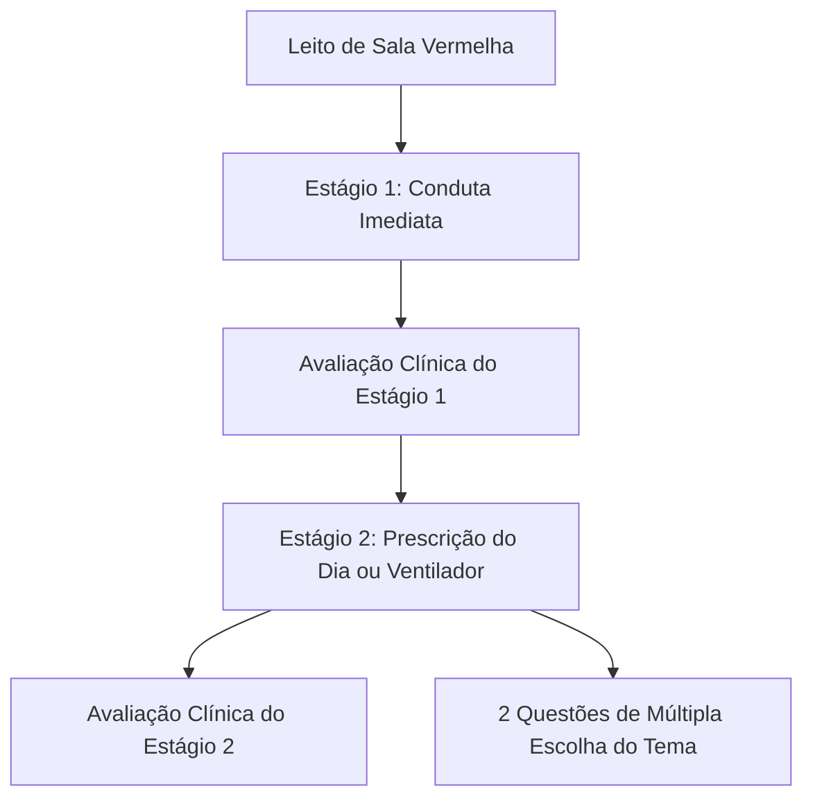

# 🩺 Regras Clínicas, Engenharia de Prompts e Invariantes do EmergeMed

> **Guia Definitivo para Agentes de IA e Desenvolvedores de Conteúdo Clínico**  
> Define as diretrizes inegociáveis de simulação médica, restrições da Sala Vermelha (UPA/SAMU), engenharia de prompts e formatação de condutas.

---

## 1. Contexto Operacional da UPA 24h e SAMU

O **EmergeMed** reflete a prática da medicina de emergência no Sistema Único de Saúde (SUS) brasileiro, especificamente em **Unidades de Pronto Atendimento (UPAs) e no SAMU de Salvador/Bahia**.

### Recursos e Limitações Locais:
* **Exames Disponíveis na UPA:**
  - ✅ Eletrocardiograma (ECG) 12 derivações imediato.
  - ✅ Raio-X de Tórax e Abdome no leito.
  - ✅ Gasometria arterial com lactato e eletrólitos rápidos.
  - ✅ Hemograma, função renal (Ur/Cr), eletrólitos, marcadores de necrose miocárdica (Troponina qualitativa/quantitativa), glicemia capilar (HGT).
  - ✅ Ultrassom Point-of-Care (POCUS) pulmonar, cardíaco e FAST.
* **Exames NÃO Disponíveis Fisicamente na UPA (Exigem Regulação):**
  - ❌ Tomografia Computadorizada (TC de crânio/tórax) — requer regulação ou ambulância avançada do SAMU.
  - ❌ Cateterismo Cardíaco / Angioplastia Primária (CATE) — a UPA deve realizar trombólise química (Tenecteplase/Alteplase) se o tempo até o CATE for > 120 min, acionando o Protocolo IAM do SAMU.
  - ❌ Trombectomia Mecânica ou UTI Neuro — requer regulação imediata pós-trombólise de AVC isquêmico.
  - ❌ Cirurgia de grande porte / Centro Cirúrgico — requer estabilização com tubo e drogas vasoativas e transferência em USA.

---

## 2. Paradigma do Caso Contínuo em 2 Estágios (Modo Plantão)

Cada leito clínico no Modo Plantão é estruturado em **duas etapas terapêuticas contínuas**:

### Regras do Estágio 1 (`prescription_immediate`):
1. **Anti-Spoiler Absoluto:** A vinheta clínica **NUNCA** deve citar o diagnóstico (ex: não escrever *"Paciente admitido com Cetoacidose Diabética"* ou *"IAM com supra de ST"*). O texto deve descrever a idade, queixa principal, tempo de evolução, histórico sucinto, sinais vitais e dados de exame físico. O médico deve inferir a hipótese diagnóstica.
2. **Objetivo Clínico:** Medidas imediatas de estabilização da primeira hora (acessos, expansão guiada por POCUS, drogas vasoativas precoces, sulfato de magnésio, broncodilatador, antiarrítmicos, intubação em sequência rápida).

### Regras do Estágio 2 (`prescription_complete` ou `ventilator`):
1. **Evolução Dinâmica:** Apresenta a resposta do paciente às medidas do Estágio 1, os resultados dos exames solicitados (gasometria, labs, ECG de controle, RX) e o status volêmico.
2. **Prescrição do Dia:** Prescrição completa de internação hospitalar de 24 horas (repouso, dieta, hidratação de manutenção, reposição de eletrólitos, antimicrobianos, sintomáticos, profilaxias de TEV e úlcera de estresse, critérios de desmame e prescrições extras/condicionais).
3. **Ventilador Mecânico (se aplicável):** Definição exata de modo (VCV/PCV), Volume Corrente (VC em ml/kg predito), Frequência Respiratória (FR), PEEP, FiO2, sensibilidade e pressão de platô / driving pressure.

---

## 3. Simulado Pós-Capítulo (10 MCQs com Mix 60/40)

Ao finalizar a leitura ou releitura de um capítulo, o teste deve conter rigorosamente **10 questões de múltipla escolha**:

### Mix de Dificuldade:
* **60% Padrão (`difficulty_tier: 'standard'`):** Cenários clássicos de emergência, reconhecimento sindrômico rápido e condutas primárias de suporte.
* **40% Avançado (`difficulty_tier: 'advanced'`):** Perguntas conteudistas e aprofundadas sobre dosagens milimétricas (ex: diluição da noradrenalina concentrada 64 mcg/ml vs 32 mcg/ml, dose de succinilcolina 1 a 1,5 mg/kg, critérios de reversão de anticoagulação oral, armadilhas diagnósticas e contraindicações formais).

### Mix de Subformatos:
* **`case_conduct`:** Caso clínico com sinais vitais e decisão terapêutica.
* **`direct_content`:** Conceito fisiopatológico, metas terapêuticas ou farmacologia.
* **`diagnostic_criteria`:** Escores (HEART, Wells, CURB-65, qSOFA, Glasgow) e critérios objetivos de gravidade.

### Estrutura de Alternativas:
* Exatamente 5 alternativas por questão.
* Sem preâmbulos de letras (`A)`, `B)`, etc.) no array `options`.
* Apenas 1 alternativa correta (`correctOption`: 0 a 4).
* Explicação pedagógica detalhada justificando por que a opção correta é a melhor e por que os distratores estão errados ou são contraindicados.

---

## 4. Ditado de Voz e IA Formatadora Rápida

### O Mandato da Inviolabilidade:
A IA formatadora de voz (`formatPrescriptionWithAI` com `xiaomi/mimo-v2.6-flash`) segue regras estritas e invioláveis:
1. **PRESERVAÇÃO TOTAL DE DOSES E NÚMEROS:** NUNCA altere, recalcule, adicione ou remova nenhum número, dose, volume, velocidade de infusão em bomba (BIC ml/h), porcentagem ou concentração prescrita.
2. **NUNCA CORRIJA ERROS MÉDICOS:** Se o médico prescreveu uma dose inadequada (ex: 500mg de succinilcolina em vez de 100mg) ou omitiu um medicamento obrigatório, **MANTENHA EXATAMENTE O QUE ELE DISSE**. A correção e atribuição de nota cabe ao avaliador clínico na etapa seguinte.
3. **CORREÇÃO APENAS DE ERROS FONÉTICOS DO MICROFONE:** O microfone comete erros de homofonia que devem ser traduzidos para a grafia correta da Sala Vermelha:
   * `"Combo ambbu"` ➔ Bolsa-válvula-máscara (AMBU)
   * `"eu suco semicolina"` ➔ Succinilcolina
   * `"Tubarão trackal"` ➔ Intubação traqueal
   * `"de luz"` ➔ diluir
   * `"com os cubo tem épigastro"` ➔ ausculta em epigástrio
   * `"ventilador mecânico"` ➔ Ventilador Mecânico
   * `"capinografia"` ➔ Capnografia
   * `"cefe triaxona"` ➔ Ceftriaxona
   * `"hemitartarato de nora"` ➔ Hemitartarato de norepinefrina (Noradrenalina)
   * `"bique"` ➔ BIC (Bomba de Infusão Contínua)
   * `"srl"` ➔ SRL (Soro Ringer Lactato)
   * `"sf zero nove"` ➔ SF 0,9%
   * `"agasometria"` ➔ Gasometria arterial
   * `"aga tê"` ➔ HGT
   * `"cloreto de potássio dez"` ➔ KCl 10%
   * `"ondansetrona"` ➔ Ondansetrona
   * `"pocus"` ➔ POCUS
   * `"pam"` ➔ PAM

---

## 5. Rubricas de Avaliação e Hierarquia de Erros

Ao avaliar a resposta do médico em `evaluatePrescriptionWithAI` ou `evaluateBedWithAI`:

| Categoria do Erro | Impacto na Nota (0 a 10) | Exemplos Clínicos |
| :--- | :--- | :--- |
| **Erro Fatal / Malefício Direto** | **-4 a -6 pontos** | Uso de betabloqueador em choque cardiogênico; nitroprussiato ou nitrato em IAM de VD; vasodilatador em estenose aórtica crítica; bolo liberal de cristaloide em edema agudo de pulmão hipertensivo; administração de glicose antes de tiamina no Wernicke. |
| **Omissão Crítica de Conduta** | **-2 a -4 pontos** | Não prescrever noradrenalina em choque séptico refratário; não realizar dupla antiagregação no IAM com supra; não solicitar TC e regulação no déficit focal agudo; não iniciar insulina em bomba na cetoacidose após volume. |
| **Erro de Posologia ou Diluição** | **-1 a -2 pontos** | Concentração errada de noradrenalina sem especificar ml/h; dose errada de sedativo ou bloqueador neuromuscular na intubação rápida. |
| **Omissão Secundária / Operacional** | **-0,5 a -1 ponto** | Omissão de profilaxia de úlcera de estresse ou TEV em paciente que ficará internado; ausência de controle térmico de rotina. |

### Separação entre Prescrição Médica e Rotina de Enfermagem:
O avaliador não deve penalizar severamente se o médico omitir cabeçalhos operacionais triviais (ex: *"passar cateter de punção periférica 18G com luvas estéreis"*), desde que a substância médica da prescrição (droga, via, dose, tempo, monitorização e metas) esteja explicitada com rigor.
