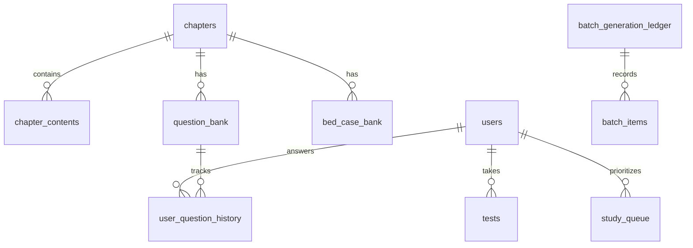

# 🩺 EmergeMed — Sistema de Treinamento e Simulação Clínica em Emergência (UPA/SAMU)

> **Ambiente de Simulação de Residência Médica em Medicina de Emergência**  
> Focado na realidade operacional de **UPAs 24h e SAMU** (Salvador/Bahia — REMUME, recursos limitados, sala vermelha, regulação para CATE/AVC/UTI).

---

## 📋 Sumário
1. [Visão Geral e Filosofia Clínica](#1-visão-geral-e-filosofia-clínica)
2. [Arquitetura de IA e Matriz de Modelos (OpenRouter)](#2-arquitetura-de-ia-e-matriz-de-modelos-openrouter)
3. [Modos de Estudo e Operação](#3-modos-de-estudo-e-operação)
   - [3.1. Modo Plantão (Leitos Contínuos em 2 Estágios)](#31-modo-plantão-leitos-contínuos-em-2-estágios)
   - [3.2. Simulado Pós-Capítulo (10 MCQs com Mix 60/40)](#32-simulado-pós-capítulo-10-mcqs-com-mix-6040)
   - [3.3. Fila de Anti-Repetição Inteligente (SRS)](#33-fila-de-anti-repetição-inteligente-srs)
   - [3.4. Ditado por Voz & IA Formatadora Ultrarrápida](#34-ditado-por-voz--ia-formatadora-ultrarrápida)
   - [3.5. Pipeline Noturna em Lote (Batch API) com Governança de Gastos](#35-pipeline-noturna-em-lote-batch-api-com-governança-de-gastos)
4. [Design System e Responsividade Móvel (Mobile & Tablet)](#4-design-system-e-responsividade-móvel-mobile--tablet)
5. [Arquitetura de Dados (PostgreSQL / Supabase)](#5-arquitetura-de-dados-postgresql--supabase)
6. [Regras Clínicas e Invariantes do Sistema (O que NUNCA fazer)](#6-regras-clínicas-e-invariantes-do-sistema-o-que-nunca-fazer)
7. [Scripts de Desenvolvimento, CLI e Testes](#7-scripts-de-desenvolvimento-cli-e-testes)

---

## 1. Visão Geral e Filosofia Clínica

O **EmergeMed** é uma plataforma concebida para treinar médicos e residentes no raciocínio clínico agudo em cenários de pronto atendimento e emergência pública.

### Pilares Fundamentais:
1. **Realismo da Sala Vermelha:** Os casos clínicos não fornecem o diagnóstico mastigado no enunciado. O médico deve avaliar a história sumária, os sinais vitais, eletrocardiograma e exames point-of-care para formular sua hipótese e prescrever.
2. **Conformidade REMUME / UPA:** Prescrições e condutas devem respeitar o arsenal real de uma UPA (ex: noradrenalina, vasopressina, tenecteplase/alteplase, ceftriaxona, dipirona, hidrocortisona, sulfato de magnésio, intubação em sequência rápida com cetamina/etomidato/succinilcolina). Não assumir tomógrafo ou hemodinâmica (CATE) dentro da UPA — condutas de repercussão exigem contato com regulação/SAMU.
3. **Liberdade de Pensamento:** Não induzir o usuário com atalhos ou botões pré-fabricados de conduta. O aprendizado ocorre na formulação autônoma da prescrição.
4. **Resiliência e Custo Marginal Zero:** Uso estratégico de modelos OpenRouter de ponta em tempo real e pipelines em lote (Batch) noturnas para alimentar bancos locais de leitos e questões.

---

## 2. Arquitetura de IA e Matriz de Modelos (OpenRouter)

O sistema utiliza a API do **OpenRouter** através de um roteador de tarefas (`lib/ai/model-router.ts`) e um executor em cascata com retentativas exponenciais (`executeWithModelCascade` em `lib/ai/openrouter.ts`).

### 2.1. Perfis de Tarefas (`AI_TASK_PROFILES`)

| Perfil (`AITaskProfileKey`) | Modelo Primário | Fallbacks | Motivo & Características |
| :--- | :--- | :--- | :--- |
| **`CLINICAL_CORE`** | `openai/gpt-6-luna` | `deepseek/deepseek-v4.1-flash`, `deepseek/deepseek-v4-flash-0731` | Raciocínio clínico profundo, geração estruturada de casos e testes com rigor farmacológico e instruções JSON estritas. |
| **`CLINICAL_EVALUATION`** | `openai/gpt-6-luna` | `deepseek/deepseek-v4.1-flash`, `deepseek/deepseek-v4-pro-0813` | Correção e scoring (0-10) de condutas do usuário, detecção de erros críticos e emissão de gabarito ideal. |
| **`CLINICAL_FEEDBACK`** | `deepseek/deepseek-v4.1-flash` | `openai/gpt-6-luna`, `deepseek/deepseek-v4-flash-0731` | Preceptoria médica e passagem de plantão em Markdown extenso. Modelo #1 em Medicina no OpenRouter com janela de 1M tokens. |
| **`DOCUMENT_EXTRACTION`** | `xiaomi/mimo-v2.6-flash` | `deepseek/deepseek-v4.1-flash`, `openai/gpt-6-luna` | Extração de capítulos de livros em PDF/texto bruto. Altíssima eficiência ($0.10 in / $0.28 out). |
| **`PRESCRIPTION_FAST_FORMAT`** | `xiaomi/mimo-v2.6-flash` | `openai/gpt-6-luna`, `deepseek/deepseek-v4.1-flash` | Formatação de voz em ~1,8 a 2,5s. Converte áudio transcrito em padrão Sala Vermelha sem token de reasoning oculto. |

### 2.2. Precificação e Economia dos Modelos Utilizados (Base: Outubro/2026)
* **`openai/gpt-6-luna`**: \$0.10 / 1M prompt \| \$0.50 / 1M completion (rápido, conciso e confiável).
* **`openai/gpt-6-luna:batch`**: **\$0.05 / 1M prompt \| \$0.25 / 1M completion** (50% de desconto para pipeline noturna).
* **`xiaomi/mimo-v2.6-flash`**: \$0.10 / 1M prompt \| \$0.28 / 1M completion (resposta direta sem overhead).
* **`deepseek/deepseek-v4.1-flash`**: \$0.0336 / 1M prompt \| \$1.188 / 1M completion (grande capacidade analítica).

---

## 3. Modos de Estudo e Operação

### 3.1. Modo Plantão (Leitos Contínuos em 2 Estágios)
O Modo Plantão simula uma passagem de plantão na Sala Vermelha com leitos simultâneos:
* **Estrutura por Leito (2 Estágios Terapêuticos):**
  1. **Estágio 1 — Conduta Imediata (`prescription_immediate`):** Paciente chega admitido com quadro agudo (ex: dispneia súbita, dor torácica, choque, rebaixamento). **A vinheta não cita o diagnóstico!** O médico prescreve as medidas imediatas (oxigênio, monitorização, expansão volêmica cautelosa, drogas vasoativas, intubação rápida ou analgesia).
  2. **Estágio 2 — Prescrição do Dia ou VM (`prescription_complete` ou `ventilator`):** O caso evolui com exames laboratoriais, gasometria e RX. O médico escreve a prescrição de internação completa de 24h ou os parâmetros do ventilador mecânico (modo, VC, FR, PEEP, FiO2).
  3. **Complemento de 2 Questões Teóricas:** Cada leito sorteia 2 questões de múltipla escolha (`question_bank`) do mesmo tema para fixação farmacológica e conceitual.
* **Banco Híbrido de Leitos (`bed_case_bank`):**
  - O sistema mescla leitos já validados do banco com leitos inéditos gerados por IA, usando probabilidade dinâmica ponderada (40% a 80%, escalando até 90% em capítulos saturados), acelerando o carregamento inicial de ~22s para ~4s.

### 3.2. Simulado Pós-Capítulo (10 MCQs com Mix 60/40)
Ao concluir a leitura ou releitura de um capítulo no sistema:
* Gera-se ou consome-se um teste de **exatamente 10 questões de múltipla escolha**.
* **Distribuição de Dificuldade Rigorosa:**
  - **60% Padrão (`difficulty_tier: 'standard'`):** Casos clínicos de emergência comuns e condutas de estabilização.
  - **40% Avançado (`difficulty_tier: 'advanced'`):** Dosagens milimétricas (mcg/kg/min, diluições, volumes), armadilhas diagnósticas (*pitfalls*), efeitos adversos críticos e contraindicações formais.
* **Subformatos Balanceados (`question_subformat`):**
  - `case_conduct`: Vinheta clínica com sinais vitais exigindo melhor conduta.
  - `direct_content`: Perguntas diretas de farmacologia e fisiopatologia.
  - `diagnostic_criteria`: Escores clínicos e critérios diagnósticos objetivos.

### 3.3. Fila de Anti-Repetição Inteligente (SRS)
Gerenciada por `lib/mcq-queue-service.ts` e persistida em `user_question_history`:
* **Hierarquia da Fila:**
  1. **P1 — Inéditas (`unseen`):** Questões que o usuário nunca respondeu.
  2. **P2 — Remediação (`wrong`):** Questões que o usuário errou anteriormente.
  3. **P3 — Fim da Fila (`correct`):** Questões que o usuário acertou só reaparecem se ele já tiver esgotado e acertado todas as outras do tema.

### 3.4. Ditado por Voz & IA Formatadora Ultrarrápida
Permite que o médico prescreva por voz no celular ou computador:
1. **Captura em Tempo Real:** Via `Web Speech API` (`webkitSpeechRecognition`) nativa do navegador em `pt-BR`.
2. **Normalização Fonética por IA:** Ao pausar o ditado ou clicar em *"✨ Organizar Padrão"*, a rota `/api/format-prescription` aciona o modelo `xiaomi/mimo-v2.6-flash`.
3. **Tempo de Resposta:** ~1,8 a 2,5 segundos.
4. **Regras Invioláveis do Prompt:**
   - **NUNCA alterar doses, volumes, concentrações, vias ou vazões.**
   - **NUNCA corrigir erros médicos** do usuário (a prescrição ditada deve ser avaliada como o médico prescreveu).
   - **Corrigir apenas erros fonéticos do microfone** usando dicionário dedicado:
     - *"Combo ambbu"* ➔ Bolsa-válvula-máscara (AMBU)
     - *"eu suco semicolina"* ➔ Succinilcolina
     - *"Tubarão trackal"* ➔ Intubação traqueal
     - *"de luz"* ➔ diluir
     - *"com os cubo tem épigastro"* ➔ ausculta em epigástrio
     - *"agasometria"* ➔ Gasometria arterial
     - *"aga tê"* ➔ HGT

### 3.5. Pipeline Noturna em Lote (Batch API) com Governança de Gastos
Script autônomo (`scripts/nightly-batch-pipeline.ts`) que roda assincronamente com o modelo `openai/gpt-6-luna:batch` (\$0.05 / \$0.25 por 1M tokens):
* **Árvore de Priorização:**
  - **Tier 1 (Fila de Estudos):** Capítulos adicionados explicitamente pelo médico na fila (`study_queue`).
  - **Tier 3 (Recomendador Top 3):** Capítulos prioritários sugeridos pelo algoritmo na página inicial.
  - **Tier 4 (Importância e Frequência Epidemiológica):** Capítulos mais frequentes da UPA (SCA, AVC, Sepse, Crise Asmática, IC descompensada).
* **Metas de Saturação:**
  - Até 6 leitos estruturados por capítulo no `bed_case_bank` (1-2 clássicos, 3-4 complexos, 5-6 atípicos).
  - Até 20 MCQs por capítulo no `question_bank` com proporção 60/40.
* **Governança Orçamentária Rígida:**
  - Tabela `batch_generation_ledger`.
  - **Hard Cap Diário:** \$0.15 USD.
  - **Hard Cap Mensal:** \$0.90 USD.
  - Interrupção automática imediata antes do envio se o teto for atingido.

---

## 4. Design System e Responsividade Móvel (Mobile & Tablet)

O layout foi refatorado para funcionar com ergonomia em **smartphones** (iPhone, Galaxy) e **tablets** (iPad, Galaxy Tab):

1. **Sidebar Responsiva (Breakpoint 1024px):**
   - Em telas `< 1024px`, a barra lateral recolhe-se em um *drawer* deslizante acionado por botão flutuante.
2. **Layout dos Leitos no Modo Plantão:**
   - Abaixo de 1024px, a coluna lateral fixa de 240px é substituída por **abas horizontais roláveis** no topo (`bed-scroll-tabs`). O card clínico ganha 100% da largura útil.
3. **Barra de Ações Fixa no Rodapé:**
   - Botões de navegação (*"Anterior"*, *"Próxima Questão"*, *"Finalizar"*) fixados na base da viewport móvel com efeito `backdrop-filter: blur(16px)`.
4. **Ajuste de Teclado Virtual:**
   - Configurado `viewport: { interactiveWidget: 'resizes-content' }` em `app/layout.tsx` para evitar que o teclado móvel quebre áreas de digitação.
5. **Remoção de Elementos Intrusivos:**
   - Barra de chips pré-prontos eliminada para preservar o espaço vertical útil em telas pequenas.

---

## 5. Arquitetura de Dados (PostgreSQL / Supabase)

### Principais Tabelas:



* **`chapters` & `chapter_contents`**: Catálogo e conteúdo integral dos capítulos do manual clínico.
* **`bed_case_bank`**: Casos de leitos de 2 estágios (`stage1_prompt`, `stage2_prompt`, `ideal_prescription`, `expected_conducts`, `difficulty_tier`).
* **`question_bank`**: Questões de múltipla escolha com 5 alternativas, gabarito, explicação e classificação (`difficulty_tier`, `question_subformat`).
* **`user_question_history`**: Registro de tentativas do usuário por questão (`times_answered`, `times_correct`, `last_is_correct`, `last_answered_at`).
* **`study_queue`**: Fila personalizada de capítulos para estudo prioritário.
* **`batch_generation_ledger`**: Registro financeiro e operacional de lotes OpenRouter (`prompt_tokens`, `completion_tokens`, `cost_usd`, `daily_accumulated_usd`, `monthly_accumulated_usd`, `hard_cap_interrupted`).

---

## 6. Regras Clínicas e Invariantes do Sistema (O que NUNCA fazer)

Para qualquer agente de IA ou desenvolvedor atuando neste repositório:

1. ❌ **NUNCA alterar doses, volumes ou condutas na formatação de voz:** O formatador (`formatPrescriptionWithAI`) serve única e exclusivamente para estruturação visual e correção fonética. Se o médico prescreveu algo errado ou subdosado, **deve permanecer errado** para que a etapa de avaliação possa pontuar adequadamente.
2. ❌ **NUNCA revelar o diagnóstico no enunciado do leito (`bed vignette`):** O caso deve descrever paciente, queixa, história, exame físico e sinais vitais. O diagnóstico é um exercício mental do usuário.
3. ❌ **NUNCA colocar chips/sugestões de condutas prontas no campo de prescrição:** O usuário proibiu expressamente botões facilitadores que entreguem respostas clínicas.
4. ❌ **NUNCA incluir plugins web (`plugins: [{ id: 'web' }]`) nas chamadas clínicas baseadas no livro:** O conteúdo do capítulo já é injetado no prompt. A busca web adiciona latência excessiva (>15s), alucinações de condutas não-SUS e custos desnecessários.
5. ❌ **NUNCA ultrapassar os Hard Caps de Batch:** \$0.15/dia e \$0.90/mês são invioláveis.
6. ❌ **NUNCA desrespeitar os recursos de UPA:** Não prescrever procedimentos de alta complexidade (CATE de emergência, RM de crânio, cirurgia de tórax aberto) como se fossem executados fisicamente dentro da UPA; a conduta correta é estabilização e regulação imediata (SAMU/Central de Leitos).

---

## 7. Scripts de Desenvolvimento, CLI e Testes

### Instalação e Execução
```bash
# Instalar dependências
npm install

# Executar ambiente de desenvolvimento (porta 3000)
npm run dev

# Verificação estrita de tipagem TypeScript
npx tsc --noEmit

# Compilação e build de produção Next.js
npm run build
```

### Pipeline Noturna em Lote (Batch CLI)
```bash
# Execução simulada com dry-run (sem gastar saldo da API)
npm run batch:dry

# Verificar status acumulado do ledger e consumo de orçamento
npm run batch:status

# Submeter lote real noturno ao OpenRouter
npm run batch:submit

# Fazer polling e ingerir resultados do lote no banco
npm run batch:poll
```

### Suíte de Testes Automatizados E2E
```bash
# Executar a suíte completa de testes opacos (Tiers 1 a 4)
npm run test:e2e
```

---
*Documentação atualizada em Outubro de 2026 para os modelos e arquiteturas mais recentes do EmergeMed.*
